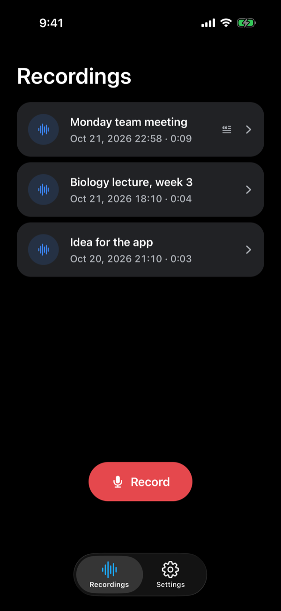
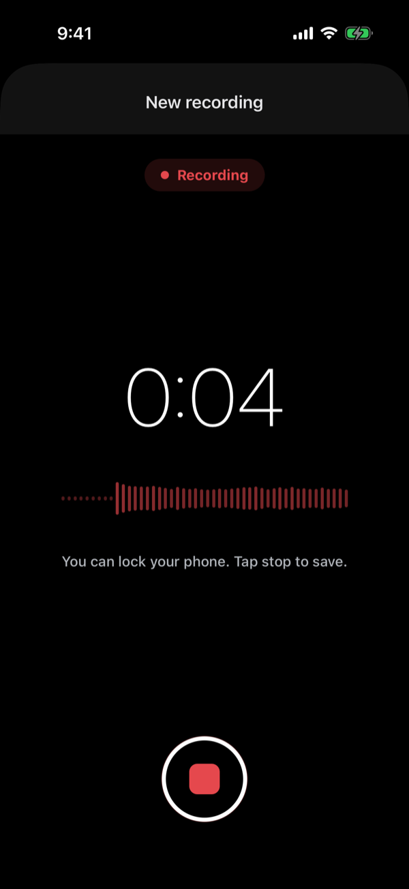
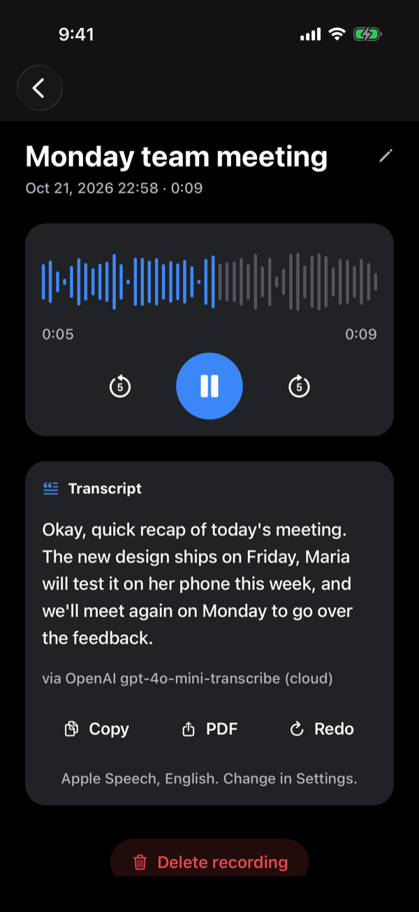
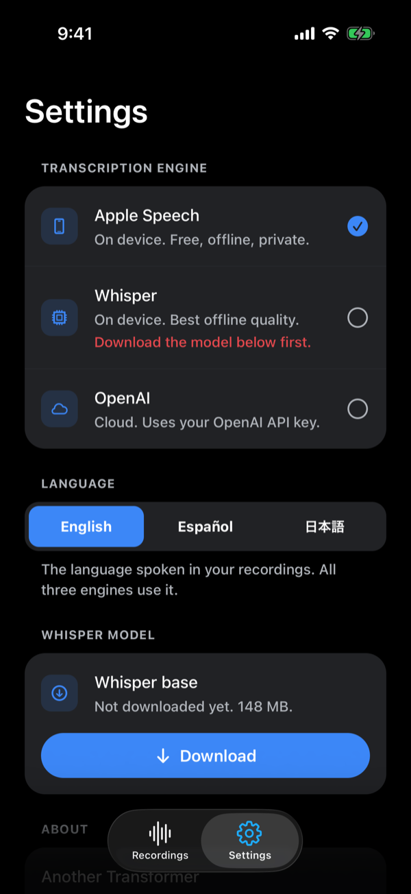

# Another Transformer

An open-source iPhone app that turns audio into text, with three transcription
engines you can switch between: Apple Speech on device, Whisper on device, or
OpenAI in the cloud with your own key. Recordings keep running while the phone
is locked. Transcribes English, Spanish and Japanese.

Built with Expo SDK 57, TypeScript and expo-router. MIT licensed.

<p align="center">
  
  
  
  
</p>

## What it does

- Record audio to a WAV file; recording survives the phone locking.
- List saved recordings with title, date and duration; rename in place, delete
  with a confirmation.
- Play back with the recording's own waveform as the seek bar, and skip 5
  seconds back or forward.
- Transcribe a recording with the engine chosen in Settings, falling back to the
  next engine when one is unavailable or returns nothing:

| Engine | Where it runs | Needs | Notes |
|---|---|---|---|
| Apple Speech (default) | On device | Nothing | Free, offline, private. Uses iOS's own recognizer. |
| Whisper | On device | One-time model download (about 148 MB) | whisper.cpp through `whisper.rn`, multilingual `base` model. |
| OpenAI | Cloud | Your OpenAI API key at build time | `gpt-4o-mini-transcribe`; audio leaves the phone. |

- Pick the spoken language in Settings (English, Español, 日本語). All three
  engines use it.
- Copy the transcript or export it as a PDF.

The three engines sit behind one `Transcriber` interface, so the app, the
router and the tests do not care which one produced the text.

## Requirements

- A Mac with Xcode and its iOS Simulator.
- Node.js 22, the version this project is developed and tested on.
- An iPhone, for the native engines. Expo Go cannot run the app.
- An Apple ID to sign the build. A free one works, but the app stops opening
  after 7 days and needs a reinstall; a paid Apple Developer account lasts a
  year.
- Optional: an OpenAI API key, for the cloud engine.
- Optional: [Maestro](https://maestro.mobile.dev), for the end-to-end flows.

## Run it

Audio recording, Whisper and speech recognition are native modules, so the app
needs a development build on a real iPhone. Expo Go cannot run it.

```bash
npm install
cp .env.example .env        # optional: add your OpenAI key for the cloud engine
npx expo run:ios --device   # builds and installs on a connected iPhone
```

The OpenAI key is read from `EXPO_PUBLIC_OPENAI_API_KEY` and inlined into the
bundle at build time. Leave it empty to use only the on-device engines. Never
commit `.env`; it is gitignored and only `.env.example` is tracked.

The Whisper model is not bundled. Download it once from Settings; it is stored
in the app's documents directory and can be deleted from the same screen.

### Useful to know

- `npx expo run:ios --device --configuration Release` builds a version that
  runs without the Metro bundler, so it works away from your Mac.
- With a free Apple ID, trust the developer once on the phone: Settings,
  General, VPN & Device Management.
- On-device Apple Speech may be unavailable on the Simulator. The app then
  falls back to the next engine, so test transcription on a real iPhone.
- Recordings and transcripts stay in the app's documents directory on the
  phone. Only the OpenAI engine uploads audio, and only in a build with a key;
  with a key, it is also the last fallback when the picked engine cannot run.

## Verify

```bash
npm test                  # jest-expo + React Native Testing Library, 146 tests
npm run typecheck         # tsc --noEmit
npm run lint              # eslint-config-expo
npm run check:boundaries  # native modules only under src/lib/adapters, lib/audio, lib/transcription
npm run e2e               # Maestro flows against a connected device; local only, never in CI
```

CI runs lint, the boundary check, typecheck and the unit and integration
tests on every push and pull request.

## Benchmark the engines

`bench/` holds the protocol for comparing the three engines on the same
recordings (word error rate against a corrected reference transcript, time to
result, and cost), and a small word error rate tool:

```bash
npm run bench:wer -- bench/samples/en-quiet-01.ref.txt bench/samples/en-quiet-01.whisper.txt
```

See `bench/README.md` for the full protocol and the results table.

## Layout

```text
src/app/              expo-router screens (thin)
src/components/       reusable presentational UI
src/hooks/            stateful workflow logic
src/lib/domain/       types and gateway interfaces (Recorder, Player, Transcriber, RecordingStore)
src/lib/adapters/     storage and native implementations
src/lib/audio/        recorder and player gateways
src/lib/transcription/ the three engines, the router and the preferences
src/lib/export/       clipboard and PDF export
src/lib/utils/        pure helpers
.maestro/             end-to-end flows (device only)
bench/                engine benchmark protocol and tools
standards/            the engineering rules the project follows
docs/PROJECT_PLAN.md  the ticket-by-ticket plan the app was built from
```

Native configuration (background audio, microphone and speech permissions) is
declared in `app.json` through config plugins; `ios/` and `android/` are
generated and gitignored.

## How it was built

The app was planned and delivered ticket by ticket with an AI coding agent
following the rules in `standards/`. `docs/PROJECT_PLAN.md` is the actual plan,
with every ticket's scope, verification and status. The write-up is at
[anothersystems.com/work/another-transformer](https://anothersystems.com/work/another-transformer).

## License

MIT, see `LICENSE`.
